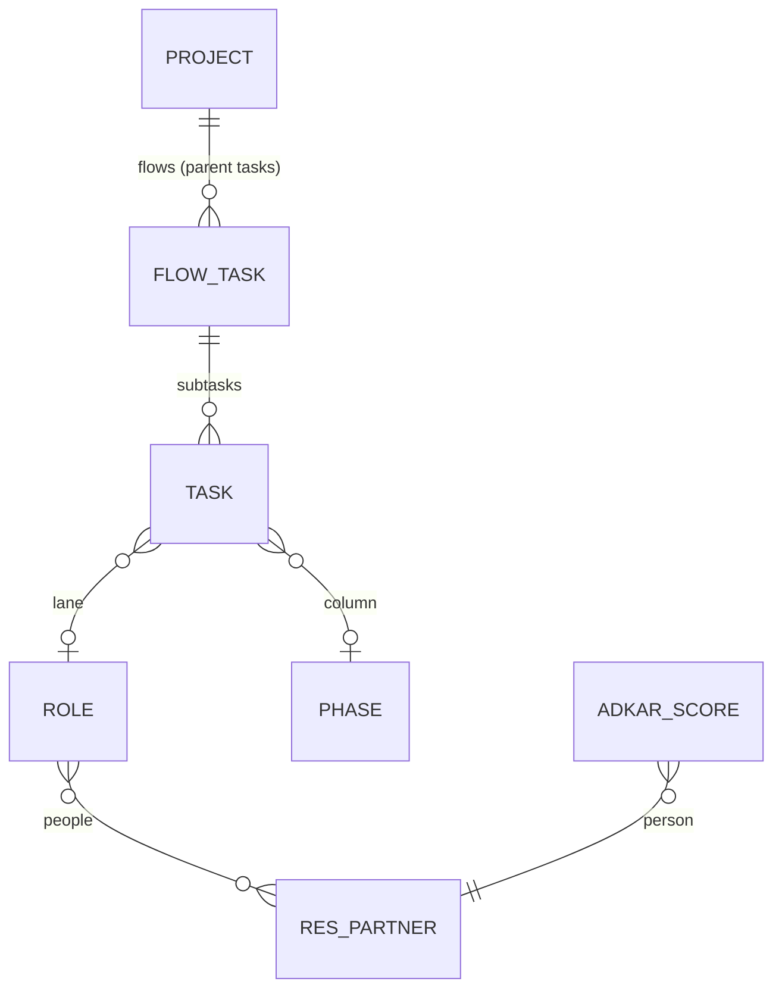

# Data model behind an Odoo implementation (v2.0, 11-11-2026)

Rule: as simple as possible. Everything is a project task; the company map is
another view on the tasks of one project, inside the Projects app (#22).

## The picture



| Concept | Where it lives |
|---|---|
| Company map | One project. The map opens from the project ("Map" button). |
| Flow (scenario, S01 ...) | A parent task in the project. Its subtasks are the flow. |
| Activity / work | A task with a role and a phase: one chip on the map. |
| Progress | `pan_rung` on the task: Open, Decided, Built, Tested, Trained, Live. |
| Choices | Rung "Decided". A choice that needs discussion is discussed in the task chatter. |
| Click path, notes | The task description. |
| Hours | Standard: allocated hours and timesheets on the task. |
| Gates | Standard project milestones. |
| Phase (map column) | `pan.sl.phase`, shared by all projects, with its Odoo apps. |
| Role (map lane) | `pan.sl.role`, per project (`project_id`), with its people (contacts). |
| ADKAR | `pan.sl.adkar.score` per person, shown as a band per role. |

A flow's "Tested %" is the share of its subtasks at Tested or further.
Cancelled tasks do not count; archived tasks do.

Removed in 2.0: chains, processes, activities, scenarios and scenario steps,
choice state, open point, Odoo model link. Production held only template
data for them, no task links and no scores (checked 11-11).

## Map contract

`project.project.get_blueprint_map_data()` on one project returns:

```json
{
  "project": {"id": 14, "name": "..."},
  "phases": [{"id": 1, "code": "quotation", "name": "Quotation",
              "apps": [{"name": "Sales", "module": "sale_management", "installed": true}]}],
  "roles":  [{"id": 3, "code": "sales", "name": "Sales", "is_external": false,
              "users": ["Name"], "adkar": "low" | "medium" | "high" | false}],
  "flows":  [{"id": 1245, "name": "S01 ...", "progress": 40, "task_ids": [1300, 1301]}],
  "tasks":  [{"id": 1300, "name": "...", "role_id": 3, "phase_id": 1,
              "flow_id": 1245, "rung": 2, "user_names": ["Name"],
              "planned_hours": 4.0, "spent_hours": 1.5, "description": "first line or false"}],
  "unplaced_count": 7
}
```

- `phases`: all phases, by sequence. `roles`: the project's roles, by sequence.
- `flows`: parent tasks of the project that have subtasks, by sequence.
- `tasks`: the project's tasks that are not a flow and have both a role and a
  phase. Cancelled tasks left out.
- `unplaced_count`: the project's other non-flow tasks (no role or no phase),
  cancelled left out. The map links to them.
- `project.project.action_blueprint_unplaced_tasks()` opens that list.

## Blueprint file (version 2)

```json
{"format": "pantalytics-blueprint", "version": 2, "lang": "en_US", "name": "...",
 "phases": [{"code": "quotation", "name": "Quotation", "sequence": 30, "apps": ["sale_management"]}],
 "roles":  [{"code": "sales", "name": "Sales", "sequence": 30, "external": false, "description": "..."}],
 "flows":  [{"name": "S13 Approve a quotation", "sequence": 130, "description": "...",
             "tasks": [{"name": "Draft the quotation", "role": "sales", "phase": "quotation",
                        "description": "<ol><li>Sales, New</li></ol>"}]}]}
```

Imported into one project. Phases match on code (shared), roles on code
within the project, flows on name within the project, tasks on name within
their flow. Import creates and fills, never deletes. Loading the template
only fills what is empty. Export writes the project in this format.
