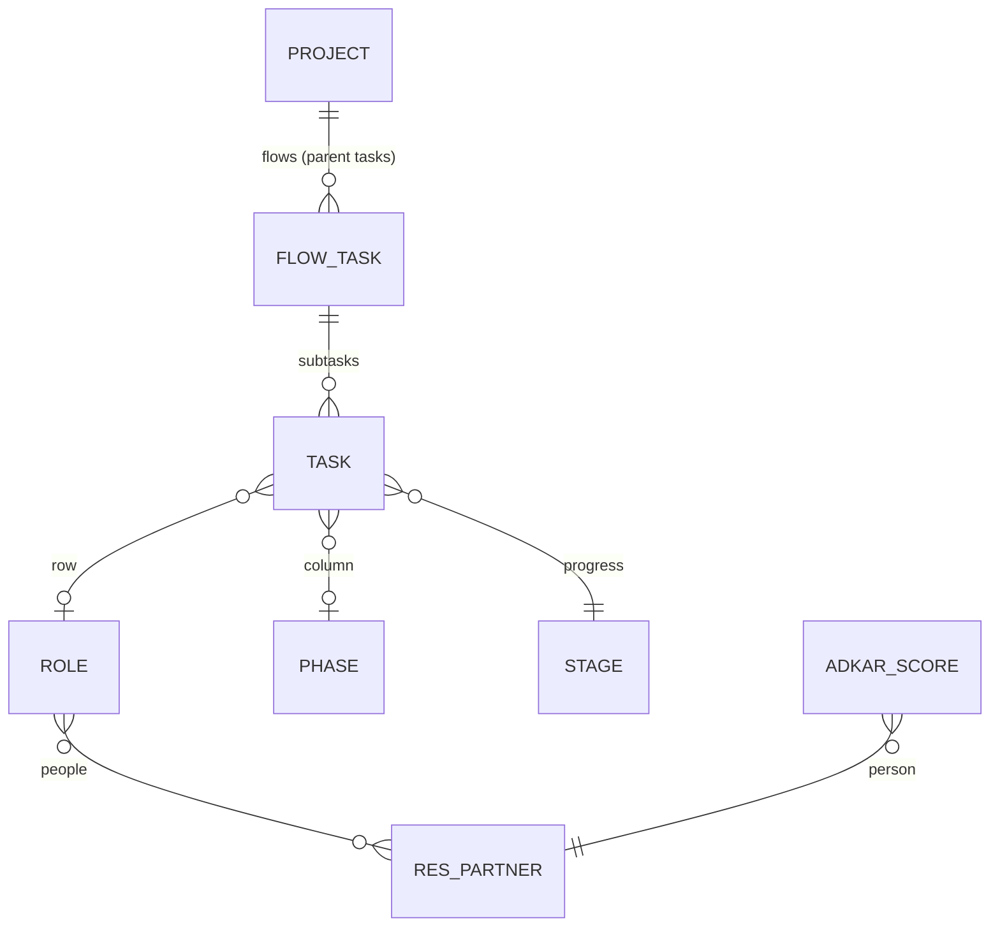

# Data model behind an Odoo implementation (v2.3, 11-11-2026)

Rule: as simple as possible. Everything is a project task; the company map is
another view on the tasks of one project, inside the Projects app (#22).

## The picture



| Concept | Where it lives |
|---|---|
| Map | One project: the "Map" view (type `pan_blueprint`) of the project's tasks, next to Kanban and List, with Odoo's search bar. Projects > Map, or "Map" on the project form and card. |
| Flow (scenario, S01 ...) | A parent task in the project. Its subtasks are the flow. |
| Activity / work | A task with a role and a phase: one chip on the map. |
| Progress | The stage: `pan_rung` on `project.task.type` (Open, Decided, Built, Tested, Trained, Live); `project.task.pan_rung` follows it (stored, read-only). The map shows four colours: grey Not started (Open), amber In progress (Decided, Built), green Tested, dark green Trained (Trained, Live). |
| Choices | Rung "Decided". A choice that needs discussion is discussed in the task chatter. |
| Click path, notes | The task description. |
| Hours | Standard: allocated hours and timesheets on the task. |
| Gates | Standard project milestones; the next one not reached answers "On schedule?" on the map. |
| Phase (map column) | `pan.sl.phase`, shared by all projects. |
| Role (map row) | `pan.sl.role`, per project (`project_id`), with its people (contacts). |
| ADKAR | `pan.sl.adkar.score` per person, shown as a band per role. |

A flow's "Tested %" is the share of its subtasks at Tested or further.
Cancelled tasks do not count; archived tasks do. The flow card on the task
kanban shows it ("Tested 40%", `pan_is_map_flow`).

A flow's stage follows its subtasks (2.2): in a project with a map, when a
subtask is created, deleted, cancelled or changes stage, parent or project,
the flow moves to the project stage whose step equals the lowest step among
its non-cancelled subtasks (archived ones count), the first such stage by
sequence. No such stage, no move. A flow inside a flow moves its parent too.
The upgrade to 2.2 does this once for every existing flow.

Loading the template (or importing a blueprint) gives a project the six
stages Open, Decided, Built, Tested, Trained, Live, each with its step, when
none of its stages has a step beyond Open yet. Same-named stages of another
project are linked, not copied; existing stages are never changed.

Changed in 2.1 (`docs/ux-test-2026-11-11.md`): progress moved from the task
to the stage. Hard call: the upgrade drops the old per-task values, so every
task starts at Open; production held them only on demo and template data.
Removed in 2.1: the phase's Odoo apps (`app_labels`, no app chips any more),
`unplaced_count` and `action_blueprint_unplaced_tasks` (the map lists tasks
without a place itself), the Company map menu (Projects > Map and
Projects > Configuration instead).

Removed in 2.0: chains, processes, activities, scenarios and scenario steps,
choice state, open point, Odoo model link. Production held only template
data for them, no task links and no scores (checked 11-11).

## Map contract

The map is a view type on `project.task` (2.3): `pan_blueprint`, named
"Map", icon `fa-map-o`, arch `<pan_blueprint/>` (view
`pan_self_learning_blueprint.view_task_map`). It sits in the project's task
action (`project.act_project_project_2_project_task_all`) after Kanban, so
the standard search bar (filters, group by, favourites) works on it.
`project.project.action_view_tasks()` leaves it out for projects without
roles and for users without the Blueprint user group. The "Tasks" menu
actions across projects do not get it: the map needs one project. The view
takes its project from the action context (`default_project_id`, else
`active_id`) and calls `get_blueprint_map_data(domain=<search domain>,
order=<view order>)`; group by does not change the map (the grid is already
grouped by role and phase).

`project.project.action_open_blueprint_map()` returns that task action with
the Map view first (also on phones) and without the "open tasks" default
filter. Projects > Map opens the client action `pan_sl_blueprint_map`: it
calls `project.project.get_blueprint_map_projects()`, which returns
`[{"id": 14, "name": "..."}]` (the projects the user can read with at least
one role, by name); with one it opens that project's Map view, with more a
plain list (`pan_sl_blueprint_map_list`). The client action with
`params.project_id` (2.2 links) opens that project's Map view.

Search filters on tasks (also in the Map view): Activity (`pan_activity`,
a task with a role and a phase), No place on the map (`pan_unplaced`),
Not decided (`pan_not_decided`, step Open), Not tested (`pan_not_tested`,
below Tested), Still to train (`pan_still_to_train`), Not live; group by
Role, Phase, Progress step.

`project.project.get_blueprint_map_data(domain=None, order=None)` on one
project returns:

```json
{
  "project": {"id": 14, "name": "..."},
  "milestones": [{"id": 2, "name": "Go-live", "deadline": "2026-12-11" | false,
                  "reached": false}],
  "phases": [{"id": 1, "code": "quotation", "name": "Quotation"}],
  "roles":  [{"id": 3, "code": "sales", "name": "Sales", "is_external": false,
              "people": ["Name"], "adkar": "low" | "medium" | "high" | false,
              "open_training_task_ids": [1300]}],
  "flows":  [{"id": 1245, "name": "S01 ...", "progress": 40,
              "deadline": "2026-12-01" | false, "late": true,
              "days_late": 5, "open_count": 2,
              "task_ids": [1300, 1301]}],
  "tasks":  [{"id": 1300, "name": "...", "role_id": 3 | false, "phase_id": 1 | false,
              "flow_id": 1245 | false, "stage": "Built" | false, "rung": 2,
              "user_names": ["Name"], "planned_hours": 4.0, "spent_hours": 1.5,
              "description": "first line or false"}]
}
```

- `domain` (optional): a `project.task` domain, such as the Map view's
  search. It restricts `tasks`, each flow's `task_ids` and the roles'
  `open_training_task_ids`; a flow keeps `progress` and `open_count` over all
  its subtasks, and a flow without a matching task is left out. Flows are
  always known from all tasks, so a domain on the flow itself does not hide
  its tasks. `order` (optional) orders `tasks`; `task_ids` keep the sequence.
- `milestones`: the project's milestones, by deadline (undated last).
- `phases`: all phases, by sequence. `roles`: the project's roles, by
  sequence. `people`: names of the role's contacts. `open_training_task_ids`:
  the role's tasks below Trained (rung < 4), the same list for each person.
- `flows`: parent tasks of the project that have subtasks, worst first:
  lowest `progress` (Tested %), then late before not late, then more
  `days_late`, then more `open_count`, then sequence. `deadline` is the task
  deadline as a date in the user's time zone; `late` means that date is
  before today and progress is below 100; `days_late` counts the days since
  (0 when not late). `open_count`: its subtasks below Tested. `task_ids`: all
  its non-cancelled subtasks (those that are no flow themselves), in order.
- `tasks`: every task of the project that is not a flow, placed or not
  (role and phase may be `false`); cancelled tasks left out. The map places
  only tasks with a role and a phase. `rung` is the stage's progress step,
  0 when the task has no stage.
- `project.project.action_blueprint_training()` opens "Still to train": the
  project's tasks with an internal role below Trained (the search filter
  `pan_still_to_train`, on by default and visible), grouped by role with the
  groups open, with the role's people (`pan_role_people`). The map's button
  "Still to train (N)" counts the same tasks: the `open_training_task_ids` of
  the internal roles.

## Blueprint file (version 2)

```json
{"format": "pantalytics-blueprint", "version": 2, "lang": "en_US", "name": "...",
 "phases": [{"code": "quotation", "name": "Quotation", "sequence": 30}],
 "roles":  [{"code": "sales", "name": "Sales", "sequence": 30, "external": false, "description": "..."}],
 "flows":  [{"name": "S13 Approve a quotation", "sequence": 130, "description": "...",
             "tasks": [{"name": "Draft the quotation", "role": "sales", "phase": "quotation",
                        "description": "<ol><li>Sales, New</li></ol>"}]}]}
```

Imported into one project. Phases match on code (shared), roles on code
within the project, flows on name within the project, tasks on name within
their flow. Import creates and fills, never deletes. Loading the template
only fills what is empty. Export writes the project in this format. A
phase's `apps` (2.0 files) is accepted and ignored.
