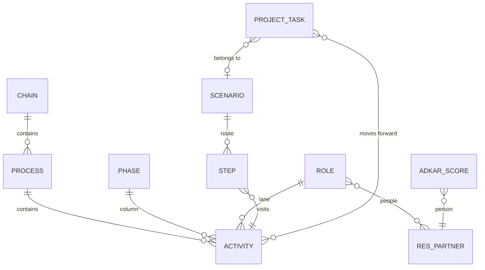

# Data model behind an Odoo implementation (v1.2, 10-11-2026)

Rule: as simple as possible. A new model only when standard Odoo has nothing
that fits; if removing it loses no function, it goes.

## The picture

Seven own models (chain, phase, role, process, activity, scenario + step,
ADKAR score). Everything else is standard Odoo.

## Decided: no new models in v1.2

| Need | Where it lives | Why not a model of its own |
|---|---|---|
| A choice and its iterations | The activity: `choice_state` plus the chatter. A choice that needs discussion is a project task tagged "Decision", linked to the activities it settles | A task already has a title, an owner, a deadline, a chatter and a link to activities |
| A requirement or user story | A project task tagged "Requirement", with the story in the description, linked to one activity | Same: the task is the unit of work, hours and estimates sit on it |
| Training | The rung "Trained" on the tasks of an activity, plus ADKAR per person (shown on the map as a band per role) | A per-person training record is detail we do not need yet |
| Gates (systeemtest, gebruikerstest) | Standard project milestones | Odoo already has them |

## The one change: people are contacts (built in 19.0.1.2.0)

Role members (`pan.sl.role.partner_ids`) and ADKAR scores
(`pan.sl.adkar.score.partner_id`) point to `res.partner` instead of
`res.users`. The workshop often has no Odoo login, but must be scored. Every
user has a partner, so users keep working. The 1.2.0 migration moves scores
and members to the user's partner.

Removed at the same time, because nothing used them: `pan.sl.role.group_ids`,
`pan.sl.phase.model_ids` and the default chains and phases data file (the
template is the one source).

## Added later only if it hurts

- A decision model with options, if tagged tasks stop being enough.
- A training record per person × activity, if the rung stops being enough.
