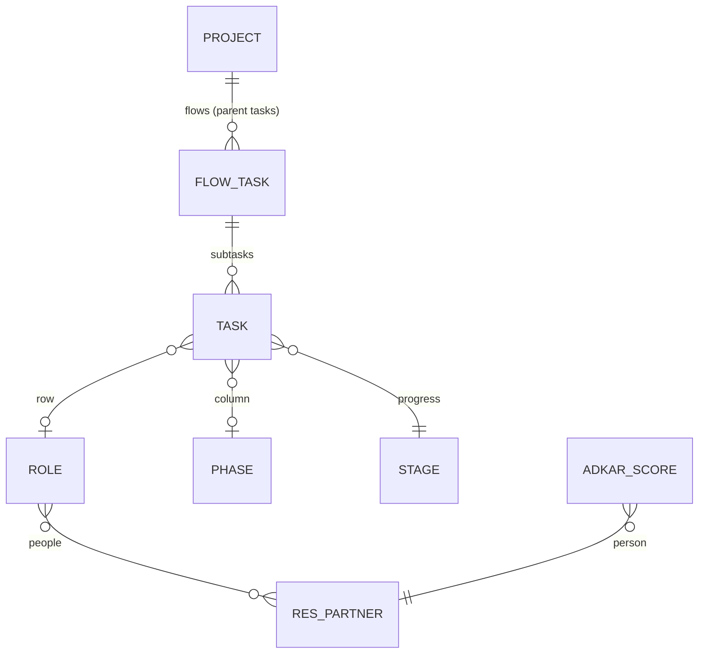

# Data model behind an Odoo implementation (v2.1, 11-11-2026)

Rule: as simple as possible. Everything is a project task; the company map is
another view on the tasks of one project, inside the Projects app (#22).

## The picture



| Concept | Where it lives |
|---|---|
| Map | One project. Projects > Map, or "Map" on the project form and card. |
| Flow (scenario, S01 ...) | A parent task in the project. Its subtasks are the flow. |
| Activity / work | A task with a role and a phase: one chip on the map. |
| Progress | The stage: `pan_rung` on `project.task.type` (Open, Decided, Built, Tested, Trained, Live); `project.task.pan_rung` follows it (stored, read-only). |
| Choices | Rung "Decided". A choice that needs discussion is discussed in the task chatter. |
| Click path, notes | The task description. |
| Hours | Standard: allocated hours and timesheets on the task. |
| Gates | Standard project milestones. |
| Phase (map column) | `pan.sl.phase`, shared by all projects. |
| Role (map row) | `pan.sl.role`, per project (`project_id`), with its people (contacts). |
| ADKAR | `pan.sl.adkar.score` per person, shown as a band per role. |

A flow's "Tested %" is the share of its subtasks at Tested or further.
Cancelled tasks do not count; archived tasks do.

Loading the template (or importing a blueprint) gives a project the six
stages Open, Decided, Built, Tested, Trained, Live, each with its step, when
none of its stages has a step beyond Open yet. Same-named stages of another
project are linked, not copied; existing stages are never changed.

Changed in 2.1 (`docs/ux-test-2026-11-11.md`): progress moved from the task
to the stage. Hard call: the upgrade drops the old per-task values, so every
task starts at Open; production held them only on demo and template data.
Removed in 2.1: the phase's Odoo apps (`app_labels`, no app chips any more),
`unplaced_count` and `action_blueprint_unplaced_tasks` (the map lists tasks
without a place itself), the Company map menu (Projects > Map and
Projects > Configuration instead).

Removed in 2.0: chains, processes, activities, scenarios and scenario steps,
choice state, open point, Odoo model link. Production held only template
data for them, no task links and no scores (checked 11-11).

## Map contract

Projects > Map opens the client action `pan_sl_blueprint_map` without
params; it calls `project.project.get_blueprint_map_projects()`, which
returns `[{"id": 14, "name": "..."}]`: the projects the user can read that
have at least one role, by name. With one, the map opens it.

`project.project.get_blueprint_map_data()` on one project returns:

```json
{
  "project": {"id": 14, "name": "..."},
  "phases": [{"id": 1, "code": "quotation", "name": "Quotation"}],
  "roles":  [{"id": 3, "code": "sales", "name": "Sales", "is_external": false,
              "people": ["Name"], "adkar": "low" | "medium" | "high" | false,
              "open_training_task_ids": [1300]}],
  "flows":  [{"id": 1245, "name": "S01 ...", "progress": 40,
              "deadline": "2026-12-01" | false, "late": true,
              "task_ids": [1300, 1301]}],
  "tasks":  [{"id": 1300, "name": "...", "role_id": 3 | false, "phase_id": 1 | false,
              "flow_id": 1245 | false, "stage": "Built" | false, "rung": 2,
              "user_names": ["Name"], "planned_hours": 4.0, "spent_hours": 1.5,
              "description": "first line or false"}]
}
```

- `phases`: all phases, by sequence. `roles`: the project's roles, by
  sequence. `people`: names of the role's contacts. `open_training_task_ids`:
  the role's tasks below Trained (rung < 4), the same list for each person.
- `flows`: parent tasks of the project that have subtasks, worst first:
  lowest `progress` (Tested %), then late before not late, then sequence.
  `deadline` is the task deadline as a date in the user's time zone; `late`
  means the deadline has passed and progress is below 100. `task_ids`: all
  its non-cancelled subtasks (those that are no flow themselves), in order.
- `tasks`: every task of the project that is not a flow, placed or not
  (role and phase may be `false`); cancelled tasks left out. The map places
  only tasks with a role and a phase. `rung` is the stage's progress step,
  0 when the task has no stage.
- `project.project.action_blueprint_training()` opens the project's tasks with
  a role below Trained, grouped by role, with the role's people (`pan_role_people`).

## Blueprint file (version 2)

```json
{"format": "pantalytics-blueprint", "version": 2, "lang": "en_US", "name": "...",
 "phases": [{"code": "quotation", "name": "Quotation", "sequence": 30}],
 "roles":  [{"code": "sales", "name": "Sales", "sequence": 30, "external": false, "description": "..."}],
 "flows":  [{"name": "S13 Approve a quotation", "sequence": 130, "description": "...",
             "tasks": [{"name": "Draft the quotation", "role": "sales", "phase": "quotation",
                        "description": "<ol><li>Sales, New</li></ol>"}]}]}
```

Imported into one project. Phases match on code (shared), roles on code
within the project, flows on name within the project, tasks on name within
their flow. Import creates and fills, never deletes. Loading the template
only fills what is empty. Export writes the project in this format. A
phase's `apps` (2.0 files) is accepted and ignored.
